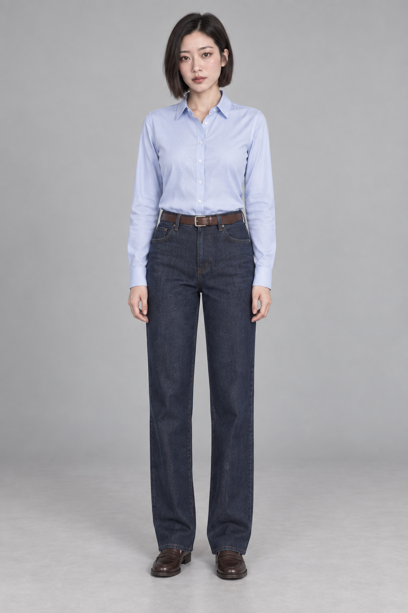
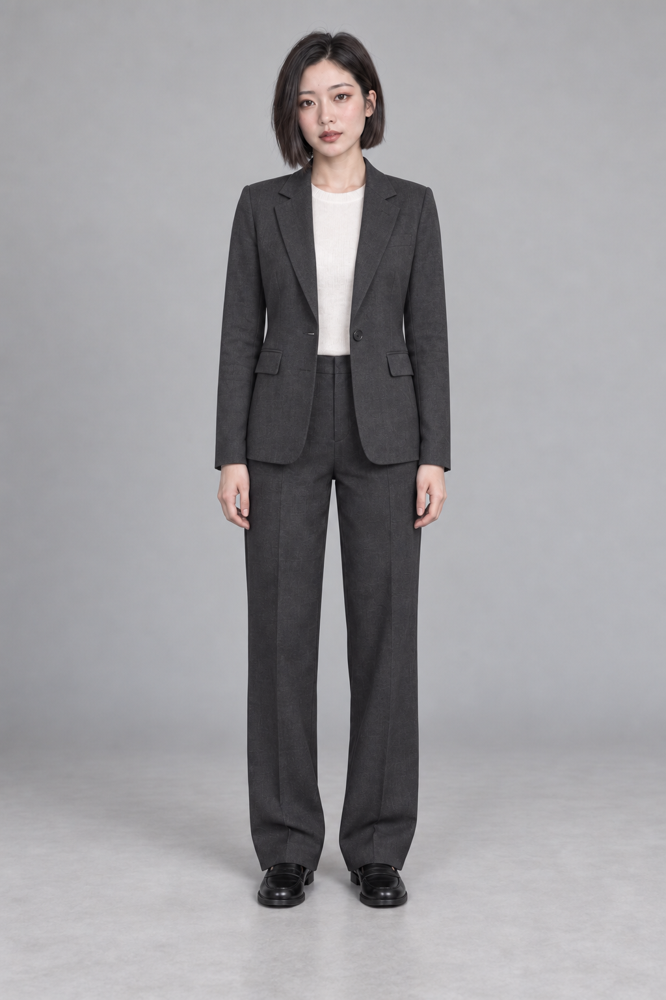
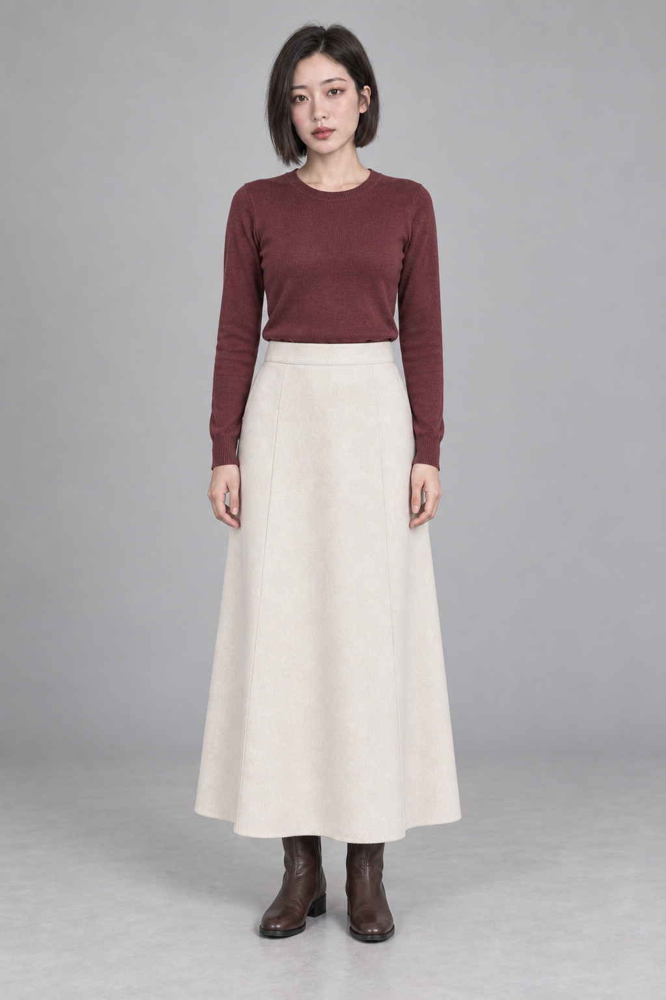
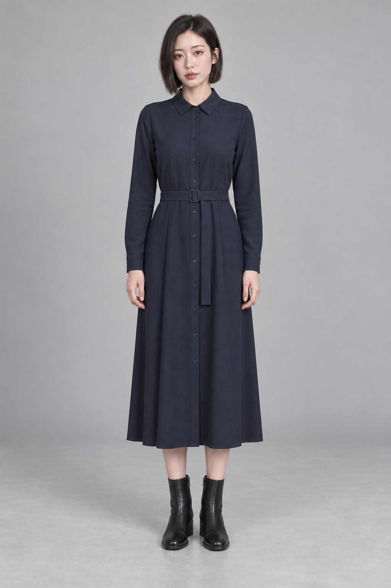
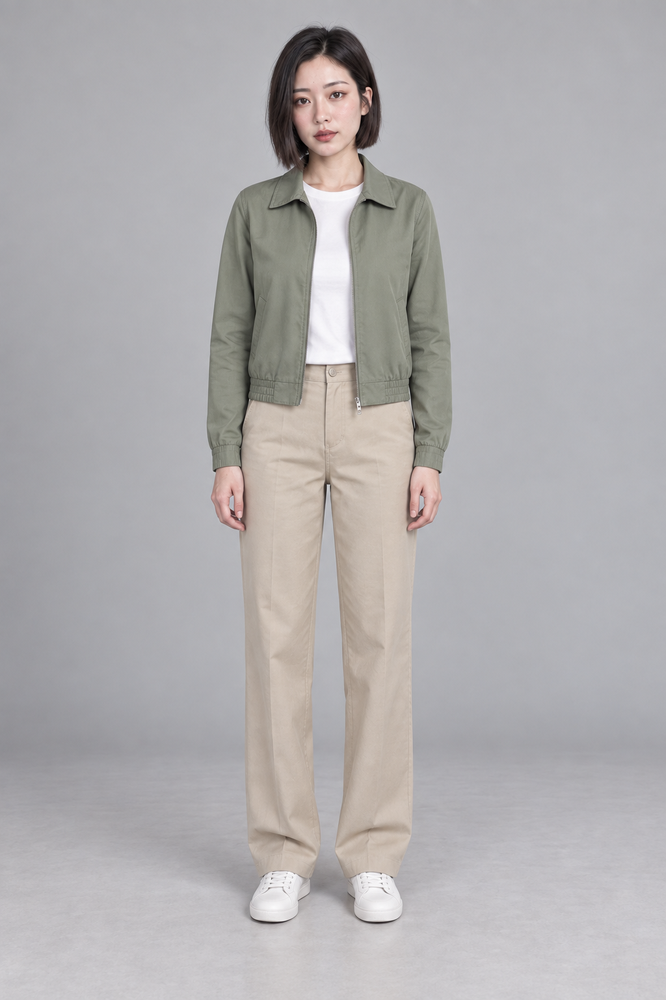

# 류수진 5가지 착장

내장 image_gen으로 개별 생성. 체형 기준 body-proportion-v2.png. 실제 판매 상품을 재현한 것이 아닌 실루엣 비교용 착장이다. 5장 시각 검토 완료: 전신·얼굴·노출 없는 의상 확인. 개별 생성이라 얼굴과 프레이밍의 미세한 차이는 남아 있다.

## 01-shirt-denim

Use case: identity-preserve. Photorealistic outfit comparison image of fictional adult Korean AI show host Ryu Sujin. Input reference is the definitive face AND body identity sheet. Use its FRONT view as the exact identity, body build, head-to-body ratio, shoulder width, torso and limb proportions, bob haircut, face and model makeup reference. Change clothing only. ONE single full-body front photograph, not a collage, portrait 2:3 composition, complete hair crown and soles, comfortable margins. Same relaxed upright front pose with arms down clear of waist, same neutral warm light gray studio background, same soft daylight, restrained natural saturation, realistic skin and fabric texture. Outfit: pale blue regular-fit cotton button-up shirt tucked neatly into dark indigo straight-leg full-length jeans, narrow brown belt, low brown loafers. Fully opaque modest clothing, no cleavage or exposed midriff. Preserve natural adult anatomy and original body shape under clothing; do not make head larger, legs shorter, waist narrower or body taller to suit outfit. Level camera and sufficient distance, no perspective exaggeration, no beautifying plastic skin, no text, no logos, no handbag or props. Produce a polished realistic fullbody photograph that makes the clothing silhouette easy to compare.

## 02-blazer

Use case: identity-preserve. Photorealistic outfit comparison image of fictional adult Korean AI show host Ryu Sujin. Input reference is the definitive face AND body identity sheet. Use its FRONT view as the exact identity, body build, head-to-body ratio, shoulder width, torso and limb proportions, bob haircut, face and model makeup reference. Change clothing only. ONE single full-body front photograph, not a collage, portrait 2:3 composition, complete hair crown and soles, comfortable margins. Same relaxed upright front pose with arms down clear of waist, same neutral warm light gray studio background, same soft daylight, restrained natural saturation, realistic skin and fabric texture. Outfit: tailored charcoal hip-length blazer over opaque ivory crewneck top, matching straight-leg charcoal trousers, black flat loafers. Fully opaque modest clothing, no cleavage or exposed midriff. Preserve natural adult anatomy and original body shape under clothing; do not make head larger, legs shorter, waist narrower or body taller to suit outfit. Level camera and sufficient distance, no perspective exaggeration, no beautifying plastic skin, no text, no logos, no handbag or props. Produce a polished realistic fullbody photograph that makes the clothing silhouette easy to compare.

## 03-knit-skirt

Use case: identity-preserve. Photorealistic outfit comparison image of fictional adult Korean AI show host Ryu Sujin. Input reference is the definitive face AND body identity sheet. Use its FRONT view as the exact identity, body build, head-to-body ratio, shoulder width, torso and limb proportions, bob haircut, face and model makeup reference. Change clothing only. ONE single full-body front photograph, not a collage, portrait 2:3 composition, complete hair crown and soles, comfortable margins. Same relaxed upright front pose with arms down clear of waist, same neutral warm light gray studio background, same soft daylight, restrained natural saturation, realistic skin and fabric texture. Outfit: soft muted burgundy regular-fit long-sleeve crewneck knit tucked into a high-waist cream ankle-length A-line skirt, brown flat ankle boots. Fully opaque modest clothing, no cleavage or exposed midriff. Preserve natural adult anatomy and original body shape under clothing; do not make head larger, legs shorter, waist narrower or body taller to suit outfit. Level camera and sufficient distance, no perspective exaggeration, no beautifying plastic skin, no text, no logos, no handbag or props. Produce a polished realistic fullbody photograph that makes the clothing silhouette easy to compare.

## 04-dress

Use case: identity-preserve. Photorealistic outfit comparison image of fictional adult Korean AI show host Ryu Sujin. Input reference is the definitive face AND body identity sheet. Use its FRONT view as the exact identity, body build, head-to-body ratio, shoulder width, torso and limb proportions, bob haircut, face and model makeup reference. Change clothing only. ONE single full-body front photograph, not a collage, portrait 2:3 composition, complete hair crown and soles, comfortable margins. Same relaxed upright front pose with arms down clear of waist, same neutral warm light gray studio background, same soft daylight, restrained natural saturation, realistic skin and fabric texture. Outfit: muted navy long-sleeve midi shirt dress, modest closed neckline, subtle same-fabric waist belt, hem at lower calf, black low-heel ankle boots. Fully opaque modest clothing, no cleavage or exposed midriff. Preserve natural adult anatomy and original body shape under clothing; do not make head larger, legs shorter, waist narrower or body taller to suit outfit. Level camera and sufficient distance, no perspective exaggeration, no beautifying plastic skin, no text, no logos, no handbag or props. Produce a polished realistic fullbody photograph that makes the clothing silhouette easy to compare.

## 05-casual

Use case: identity-preserve. Photorealistic outfit comparison image of fictional adult Korean AI show host Ryu Sujin. Input reference is the definitive face AND body identity sheet. Use its FRONT view as the exact identity, body build, head-to-body ratio, shoulder width, torso and limb proportions, bob haircut, face and model makeup reference. Change clothing only. ONE single full-body front photograph, not a collage, portrait 2:3 composition, complete hair crown and soles, comfortable margins. Same relaxed upright front pose with arms down clear of waist, same neutral warm light gray studio background, same soft daylight, restrained natural saturation, realistic skin and fabric texture. Outfit: sage green waist-length casual zip jacket over opaque white crewneck tee, beige straight-leg full-length chinos, simple white low-top sneakers. Fully opaque modest clothing, no cleavage or exposed midriff. Preserve natural adult anatomy and original body shape under clothing; do not make head larger, legs shorter, waist narrower or body taller to suit outfit. Level camera and sufficient distance, no perspective exaggeration, no beautifying plastic skin, no text, no logos, no handbag or props. Produce a polished realistic fullbody photograph that makes the clothing silhouette easy to compare.
