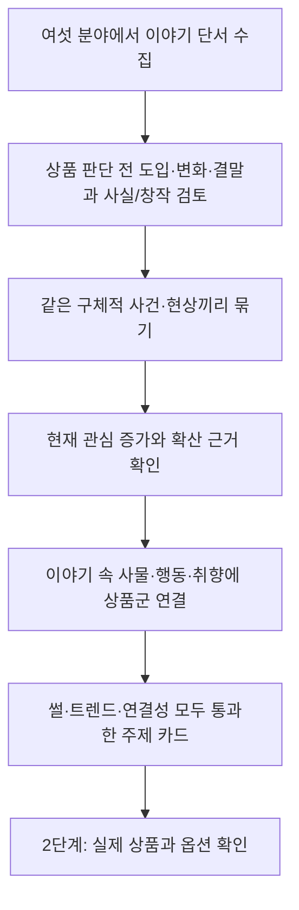

# 1단계 재설계: 트렌드에 맞는 썰과 상품 연결의 교집합

작성일: 2026-09-23. 설계 ID: `story-trend-commerce-v2`.

상태: 2026-09-23 사용자 진행 요청으로 새 수집기·근거/검토 계약·API·주제 화면·1→2단계 인계를 구현하고 첫 실데이터 배치를 실행했다. 아래 임계값은 초기 운영 가설이며 검증된 성과 기준이 아니다. 5단계 대본 계약 확장은 아직 별도 작업이다.

## 1. 목표와 판정 단위

목표는 **현재 관심이 커지는 주제를 재미있는 썰로 풀고, 그 이야기 안에 있는 사물·행동·취향에 상품을 자연스럽게 연결하는 것**이다. 메인은 이야기이고 쇼핑은 부가 요소다.

1단계 출력 단위는 채널이나 상품이 아니라 `주제 + 이야기 각도`다. 예를 들어 같은 러닝 주제라도 소비 유행, 경기 중 벌어진 사건, 장비가 생긴 배경은 서로 다른 각도다. 같은 사건을 재업로드한 여러 영상은 독립적인 유행 근거로 세지 않는다.

채택 조건은 다음 세 항목의 교집합이다.

1. 이야기 자체의 가치: 상품명·구매 권유를 지워도 도입의 질문과 결말이 남는다.
2. 현재 관심의 근거: 최근 조회 증가, 여러 독립 창작자의 확산, 검색 관심 변화 등 관측 가능한 근거가 있다.
3. 자연스러운 상품 연결: 상품이 이야기 속 핵심 사물, 행동을 따라 하는 도구, 취향을 표현하는 물건, 실제 불편의 관련 해결 수단 중 하나다.

어느 한 항목이 부족한 것을 다른 항목의 높은 점수로 상쇄하지 않는다. 상품이 등장한다는 이유만으로 채택하지 않고, 이야기와 상관없는 인기 상품을 끝에 붙이지 않는다.

## 2. 기존 구조의 편향

- `scripts/discover_shopping_channels.py`는 추천템·쿠팡·다이소 등의 검색군과 `commerce_signal='keyword_probable'`을 중심으로 후보와 비교군을 만든다. 쇼핑 키워드가 없는 좋은 썰은 진입하기 어렵다.
- `packages/contracts/models.py`의 `Snapshot.commerce_type`은 demo/review/unboxing/buying_guide/unrelated/unknown이다. 썰은 독립 유형이 아니다.
- `workers/discovery/outliers.py`는 commerce가 unknown/unrelated인 관측을 제외한다. 쇼핑 표기가 없는 썰의 급등도 탈락할 수 있다.
- 쇼핑 태그가 있는 채널인지 검증하는 작업은 상품 연결 가능성을 직접 증명하지 않는다. 기존 원본 영상에 태그가 없어도 새로운 이야기에는 적절한 상품을 연결할 수 있다.
- 단일 영상의 누적 조회수 이상치는 역사적 히트작의 증거다. 현재 주제의 유행을 뜻하지 않는다.
- 원 설계도 단계명과 비교군이 쇼핑 영상에 맞춰져 있다. 최신 사용자 설명을 우선해 탐색 목적과 입출력을 바꾼다.

## 3. 탐색 흐름

### 3.1 초기 단서를 넓게 얻는다

초기 표본에는 생활 썰, 소비문화, 음식·문화의 유래, 신기한 사실, 취미·스포츠 일화, 물건에 얽힌 사건, 일상 관계 이야기를 포함한다. `썰`이라는 단어가 제목에 없어도 수집할 수 있어야 한다. 고정된 상품 검색어를 고정된 썰 검색어로 바꾸는 것만으로 끝내지 않는다.

- 공식 YouTube API: 일반 썰·지식·생활·문화 채널의 공개 영상 메타데이터와 관측 시점별 조회수. 상품 태그·PPL·쇼핑 키워드를 진입 조건으로 사용하지 않는다.
- Chrome/Luna: 계정에서 이용 가능한 YouTube Studio 트렌드 화면, 공개된 원문·기사·영상의 제한된 직접 확인. 제목만 본 경우 `metadata_only`로 기록한다.
- 검색 트렌드: 관측한 구체적 주제의 관심 증가를 보강한다. 연결되지 않은 API를 연결된 것으로 가정하지 않는다.
- 기존 카탈로그: 내용이 이야기 중심인 표본과 과거 히트 구조를 참고하는 보조 자료다. 쇼핑 검색으로 수집된 23만 영상은 일반 썰 시장의 대표 표본이 아니다.

검색어는 관측한 소재에서 매 실행 새로 만든다. `주제의 이름/별칭`, `사건`, `행동`, `왜 화제가 됐는지`를 확장하고, 결과에서 나온 새 개체·현상을 다시 탐색한다. 상품명 검색은 연결 검증 단계에서 수행한다. YouTube 검색의 한국 지역·한국어 관련성은 한국어 콘텐츠의 보증이 아니므로 실제 언어·대상도 확인한다.

### 3.2 영상들을 주제로 묶는다

각 관측을 `개체 + 사건/현상 + 맥락 + 이야기 각도`로 표현하고 Luna가 근거 문장을 지정한다. 코드는 ID와 날짜를 검증하고 중복을 합친다.

`러닝`, `음식`, `연애` 같은 광범위한 분야만 같다고 같은 주제로 묶지 않는다. 동일 원본·같은 보도자료·재업로드·사실상 같은 채널 네트워크는 독립 확산을 과대계산하지 않도록 출처 관계를 남긴다. 제목 유사도만으로 원본 동일성을 확정하지 않는다.

### 3.3 지금 유행하는지 검증한다

최근 7일을 기본 탐색 창, 28일을 비교 문맥으로 제안한다. 하루 이슈는 24~72시간 창을 추가한다. 업로드 연령 제한 없이 과거 영상도 참고할 수 있지만, 지금 추천하려면 현재 관심의 근거가 필요하다.

| 근거 | 사용 방법 | 불충분한 대체값 |
|---|---|---|
| 최근 조회 증가 | 실제 두 관측의 차이/경과 시간. 서로 다른 길이의 구간은 명시 | 누적 조회수/영상 나이로 현재 속도 추정 |
| 채널 내 평소 대비 반응 | 같은 포맷·비슷한 게시 후 경과 시점의 과거 관측. 비교군 부족은 별도 상태 | 대형 채널이라는 이유, 후보 자신이 포함된 중앙값 |
| 여러 창작자로의 확산 | 같은 구체적 주제를 다룬 독립 원본 수와 날짜 | 재업로드 수, 같은 원문의 재인용 수 |
| 검색 관심 변화 | 같은 제공자·동일 조건에서 기간별 추이 | 뉴스 건수만으로 수요 확정, 다른 요청의 상대 지수 단순 합산 |

초기에는 최근 증가와 독립 확산 등 서로 다른 종류의 근거 두 가지를 갖춘 주제를 우선한다. 첫 관측만 있거나 한 영상만 급등한 경우 `trend_unconfirmed`로 남긴다. 검색 관심이나 최근 원문으로 보강할 수 있지만 없는 과거 조회수를 생성하지 않는다.

트렌드 원자료, 관측 구간, 표본 수를 그대로 표시한다. 처음부터 임의 가중합을 '히트 확률'로 만들지 않는다. 같은 주제의 공급이 많아졌다는 사실과 시청자 관심이 커졌다는 사실도 구분한다.

### 3.4 썰의 구조를 확인한다

Luna가 실제 확인한 내용에서 다음을 작성한다.

- `hook`: 구매 권유 없이 궁금해지는 한 문장.
- `setup`: 누가 어떤 상황에 놓였는가.
- `turn`: 예상과 다른 일, 갈등, 발견, 이유.
- `payoff`: 시청자가 끝까지 본 뒤 얻게 되는 답이나 감정.
- `claims`: 이야기에서 사실로 말할 내용과 각각의 원문·근거 구간.
- `source_observation`: 확인한 범위, 관측 도구, 일시. 영상/오디오를 확인하지 못했으면 명시.

썰을 모두 `불편 → 제품 등장 → 해결 → 구매` 형태로 바꾸지 않는다. 일화, 유래, 역설, 소비문화, 실험·관찰 등 이야기 구조를 살린다. 관측 없는 제목 추측은 시청·전사 검증 대기 상태다. 실화, 사실 설명, 창작 상황극을 구분하고 창작을 실제 경험으로 둔갑시키지 않는다.

### 3.5 자연스러운 상품 연결을 찾는다

상품군 목록은 이야기와 별도로 보유하되, 이야기에서 확인된 사물·행동·취향과 의미상 맞는 경우에만 연결한다.

| 연결 역할 | 설명 | 통과 조건 |
|---|---|---|
| 이야기 속 사물 | 이야기의 궁금증이나 발견에 등장하는 물건 | 실제 관련 장면/근거가 있다 |
| 행동을 따라 하는 도구 | 시청자가 이야기 속 행동을 재현할 때 쓰는 물건 | 핵심 행동과 기능이 맞는다 |
| 취향의 표현 | 취미·문화·스타일 이야기와 직접 관련된 물건 | 유명인·등장인물이 해당 제품을 썼다는 오해를 만들지 않는다 |
| 관련 불편의 해결 수단 | 이야기 속 실제 불편에 연결되는 물건 | 효과를 과장하지 않고 상품 주장 근거를 확인한다 |

후보마다 상품 연결을 최대 3개까지 제안하고 다음 두 질문에 답한다.

1. 상품 설명과 링크를 빼도 같은 훅·전개·결말이 유지되는가?
2. 이 상품을 전혀 무관한 물건으로 바꾸면 연결이 어색해지는가?

첫 질문이 아니면 제품 광고가 메인이다. 두 번째가 아니면 아무 이야기 끝에나 붙일 수 있는 억지 연결이다. 상품이 이야기 안에서 중요한 소재여도 괜찮지만 판매 설명이 이야기의 목적을 대신하면 탈락한다. 연결 방식은 상품 태그만, 자연스러운 짧은 언급, 이야기 속 활용 등으로 선택하고 CTA를 필수로 강요하지 않는다.

## 4. 판정 예시

아래는 구조 설명을 위한 가상 후보다. 현재 유행한다거나 제목의 전제가 사실이라고 조사 완료한 예시가 아니다.

| 탐색할 이야기 각도 | 자연스러운 연결 후보 | 추가로 필요한 검증 |
|---|---|---|
| 스마트폰이 있는데 일회용 카메라를 다시 찾는 사람들의 이유 | 일회용 카메라·사진 보관 앨범 | 실제 관심 증가, 소비 이유의 원문, 모델별 차이 |
| 마라톤 보급소에서 특정 간식이 등장하게 된 배경 | 이야기에서 실제 확인된 간식 | 대회·관행의 사실, 현재 관심, 과장된 건강 효과 제외 |
| 호텔에 베개가 여러 개 놓인 이유를 따라가는 이야기 | 베개·베개 커버 | 호텔별 사실과 일반화 한계, 최근 주제 수요 |
| 핫딜 상품 가격·성능 5개 나열 | 상품 연결은 쉽지만 이야기 구조가 약함 | 썰 중심 최종 후보에서 제외 |
| 화제인 연예인 논쟁 끝에 무관한 주방용품 소개 | 무관한 상품 | 연결성 탈락 |

## 5. 1단계 결과물과 상태

결과물 `StoryOpportunity`는 다음을 포함한다.

- `topic_id`, `topic_label`, `angle`, 대상 언어·지역.
- `why_now`: 지금 다룰 이유, 기간, 출처 IDs, 계산한 원지표, 부족한 관측.
- `reference_video_ids`, `source_family_ids`: 대표 원본과 중복·파생 관계.
- `story`: hook/setup/turn/payoff와 주장별 근거.
- `product_bridges`: 연결 상품군, 역할, 연결 이유, 보여줄/언급할 위치, 정확한 제품 또는 유사 대안 여부.
- `story_gate`, `trend_gate`, `bridge_gate`: pass/fail/unknown 및 각각의 근거.
- `status`: `metadata_only`, `needs_observation`, `trend_unconfirmed`, `no_natural_bridge`, `story_not_primary`, `ready_for_product_research`.
- `observed_at`, `window_start`, `window_end`, `evidence_ids`, 실제 작업의 모델·도구 기록.

`ready_for_product_research`는 세 게이트가 모두 pass이고 핵심 사실 근거가 확인된 경우에만 부여한다. 이것은 상품 확인이나 제작·게시 승인까지 뜻하지 않는다. 트렌드는 강하지만 상품 연결이 없는 주제는 별도 이야기 참고함에 보관한다.

UI는 채널 수와 쇼핑 태그 수 대신 **주제 / 지금 뜨는 근거 / 이야기의 핵심 / 연결 상품군 / 자연스러운 이유 / 미확인 항목**을 보여준다. 상품을 골랐다는 이유로 순위를 올리지 않는다. 통과 주제는 최근성·관측 강도·소재 다양성을 기준으로 편집 순서를 정한다.

## 6. 이전 데이터와 활동 필터 처리

- 기존 채널·영상·태그 관찰 원자료를 보존한다. 기존 139개 활동 통과 채널이나 138개 잠정 이상치를 새 목적에 적합한 주제로 자동 승격하지 않는다.
- 최근 90일 5개 이상 업로드 기준은 유지하며, 지속 추적할 채널을 고르는 데 적용한다. 90일은 앞서 합의한 3개월의 구현 정의다.
- 최소 5개를 실제 확인했으면 활동 통과. 90일 구간 또는 전체 업로드를 충분히 확인한 뒤에도 5개 미만일 때만 기준 미달이다. 미수집·부분 수집은 `activity_unknown`이며, 통과 목록에서 보류하되 비활성으로 단정하지 않는다.
- 오래된 사례·기사·과거 히트 구조는 참고할 수 있다. 비활성 채널을 다시 추적 대상으로 넣거나 오래된 조회수를 현재 유행으로 사용하는 근거는 아니다.
- 앞으로 모든 채널의 전체 과거 영상을 먼저 채우지 않는다. 최근 업로드로 활동과 이야기 유형을 확인하고, 유망 후보의 비교군과 관련 과거 사례만 우선 보강한다.
- 전체 23만 영상을 매번 갱신하는 대신 검토 중인 주제의 대표 영상과 비교군을 우선 관측한다. 이번 실행의 관측 시점·범위를 기록한다.

## 7. 구현 변경 범위

| 영역 | 변경 |
|---|---|
| 탐색 실행기 | `scripts/discover_story_topics.py` 구현. 주제 단서 수집·검색 확장·후보군 생성. 기존 쇼핑 채널 도구는 보조 분석으로 구분 |
| API 관측 | 기존 버킷 분리·배치 통계·키 비노출 처리를 재사용. 최근 관측 대상 집합만 갱신 |
| 이야기 구조화 | 현재 Codex 작업의 Chrome/Luna 관측으로 증거를 반환. 앱이 하위 에이전트를 호출하는 방식은 쓰지 않음 |
| 스키마 | StoryObservation/TopicEvidence/ProductBridge/StoryOpportunity를 버전 분리해 추가. commerce_type에 story 하나만 추가하는 편법으로 끝내지 않음 |
| 관심 비교 | 쇼핑 키워드 진입 조건 제거. 같은 영상의 조회 속도 변화를 현재 관심 지표로 사용. 이야기 포맷별 충분한 비교군을 이용한 이상치 순위는 후속 보강 |
| 1→2단계 | 단일 레퍼런스의 상품 태그 대신 선정 주제와 상품 연결 후보를 넘김. 원본 속 정확한 상품과 새로 제안한 대안을 구분 |
| 5단계 대본 | 후속 범위. 선정 주제는 프로젝트 context에 전달되지만, 기존 대본의 상품 주장 계약을 이야기 사실 근거까지 확장한 것은 아님. 실제 제작 전 별도 검증 필요 |
| UI/API | 새 주제 목록과 상세 근거 화면을 추가. 구 `outlier`를 새 주제 확정 결과로 표시하지 않음 |

Luna로 수행 가능한 관측·분류 계약을 기본으로 하고 Jev는 이후 품질 비교용 확장으로 둔다. 설계 문서나 모델 선호 설정만으로 실제 Luna 실행을 주장하지 않는다. 새 키나 예약 실행을 필수 선행조건으로 두지 않는다.

## 8. 첫 검증 배치

1. 일반 썰·지식·문화·생활 등 서로 다른 영역에서 새 주제 후보를 확보한다. 초기 목표는 중복 제거 후 20개 주제이며 수량을 맞추려고 근거를 만들지 않는다.
2. 메타데이터로 후보를 좁힌 뒤 각 주제의 대표 원본 1~3개를 직접 확인한다. 복제 영상은 독립 표본에서 제외한다.
3. 동일 관측 기간의 트렌드 근거를 붙이고, 이력이 부족하면 `trend_unconfirmed`로 남긴다. 후속 관측은 사용자가 실행할 때만 수행한다.
4. 각 후보에 이야기 구조와 상품 연결을 기록한다. 최종 5개 수준의 검토 목록을 목표로 하되 교집합이 없으면 없다고 보고한다.
5. 실패를 `상품 광고 중심`, `이야기 약함`, `현재 유행 근거 부족`, `상품 연결 억지`, `사실 미확인`, `복제 중복`으로 나눠 검색 확장·관측 우선순위를 수정한다.

첫 성공 지표는 채널/영상 수가 아니라 검토자가 납득하는 교집합 후보의 수, 근거 완성도, 후보당 확인 시간이다. 이후 실제 제작 성과를 확보한 경우에만 시청 성과·상품 클릭·전환을 서로 구분해 평가한다.

## 9. 확인한 공식 기능과 한계

- [YouTube search.list](https://developers.google.com/youtube/v3/docs/search/list): 검색은 후보 생성이다. 날짜순·조회수순 정렬 자체가 현재 상승 속도나 주제 유행의 판정은 아니다.
- [YouTube videos.batchGetStats](https://developers.google.com/youtube/v3/docs/videos/batchGetStats): 공개 영상의 현재 통계를 받아 실제 관측 이력을 쌓는 경로다.
- [YouTube Studio Trends](https://support.google.com/youtube/answer/11962757?hl=en): 인기 검색·유사 창작자의 잘된 영상·Shorts 콘텐츠 공백 등 주제 단서를 제공한다. 일부 기능은 국가·언어·기기와 해당 계정의 문맥에 제한되므로 한국 전체의 대표 순위로 취급하지 않는다.
- [네이버 데이터랩](https://developers.naver.com/products/service-api/datalab/datalab.md): 검색 관심과 쇼핑 클릭 관심을 별도로 관측할 수 있다. 상대 지수이며 절대 검색량·판매량이 아니다.
- [네이버 검색어 트렌드 API](https://developers.naver.com/docs/serviceapi/datalab/search/search.md): 클라이언트 ID/시크릿과 API 권한이 필요한 선택 연결이다. 현재 연결 여부를 확인하지 않았으며 기본 가용 기능으로 표시하지 않는다.

## 10. 구현과 첫 실데이터 검증

- 실제 검색 3건에서 영상 70개를 수집하고 같은 70개의 공개 통계를 별도 버킷으로 관측했다. 4번째 검색은 HTTP 429, 채널 활동 조회는 HTTP 403으로 중단됐다. 이전 카탈로그를 새 수집으로 세지 않았다.
- 4개 주제를 검토했다. 떡·뽁뽁이·플레이도우는 실제 자막/원출처로 이야기와 상품군의 연결을 검토했다. 푸딩 몰드는 일부 프레임만 확인해 `needs_observation`이다. 원본 영상 전체를 본 것으로 기록하지 않는다.
- 현재 통과 주제는 0개다. 활동 확인 미완료와 시간에 따른 관심 증가 근거 부족을 데이터와 화면에 남긴다. [생성 보고서](../data/reports/story-discovery/latest.md)는 코드로 갱신된다.
- `StoryEvidence`, `StoryTopicReview`, `StoryCollectionRequest`, `StorySelection` 계약과 생성 JSON Schema는 `packages/contracts`에 있다. 자료·검토·관측 원문은 기존 SQLite의 별도 `story-*` 레코드로 해시 보존한다.
- 의미 검토는 현재 작업의 운영자 진술이다. 본문 검토 완료 여부, 사실별 근거 ID, 출처 가족과 독립성 설명을 요구한다. 선호 모델은 Luna이며 이번 관측의 실행 기록은 GPT-6이다. JEV·하위 에이전트·새 예약은 사용하지 않았다.
- 초기 트렌드 통과는 최근 28일 안의 독립적인 원출처 가족 2개 이상과 다음 중 하나를 요구한다: 같은 기준 검색 관심 지수 1.25배 이상 상승(기준점도 28일 이내, 최근점 7일 이내, 최소 1일 간격), 또는 최근 7일 관측 3개로 계산한 조회 속도 1.5배 이상 상승 및 마지막 구간 1,000회 이상 증가. 조회 구간은 각각 6~72시간이다. 짧은 간격 재관측은 별도 표본 수를 부풀리지 않는다.
- 통과한 주제만 수정 가능한 프로젝트의 `story_topic_id`에 연결할 수 있다. 진행 중 작업, stale revision, 미검증 주제는 거절한다. 상품/대본을 이미 시작한 프로젝트의 주제 변경도 거절한다.
- 현재 기본 검색 창은 7일, 수동 조정 범위는 1~28일이다. 오래된 영상·기사는 역사 참고로 쓸 수 있으나 신규 검색은 최근 주제 단서를 우선한다. 검색 결과는 언어·형식·이야기성의 검증이 아니다.

## 11. 이야기 첫 검토 및 복구 경로 구현 (2026-09-23)

- `NarrativeIntake`는 상품 필드 없이 이야기 후보·제외·본문 대기를 기록한다. 후보는 근거 ID, 도입·변화·결말과 콘텐츠 유형이 필요하다. 검색 제목만으로 후보로 확정할 수 없다. 창작 표시는 주제 검토 단계에서도 유지하며, 창작 표시가 사라지면 이야기 게이트가 통과하지 않는다.
- 6분야 18개 출발 질문을 분야별 최근 성공 시점에 따라 순환한다. 첫 검토에서 나온 구체적 후속 질문을 추가한다. 읽기 큐는 분야를 교대로 배치하고 동일 채널은 최대 2개로 제한한다. 신선한 활동 기준 미달 채널은 큐에서 제외하며 활동 미확인은 별도 표시한다.
- 상세 정보 쿼터 오류로 수집 영상이 사라지던 경로를 수정했다. 검색 원문에서 19개 새 후보를 복구하여 기존 70개와 합쳐 89개가 됐다. 19개는 길이·Shorts 여부 미확인이다. 기존 주 키의 통계 버킷 2회 호출로 89개 전부의 조회수를 관측했다.
- 첫 검토 5건: 이야기 후보 2건, 본문 대기 3건. 신혼부부의 별도 침대 창작 이야기를 Chrome 주요 프레임과 전체 자동 자막으로 확인했고, 기존 스브스뉴스 식감 문화 해석의 자막 근거도 연결했다. 관계 이야기에는 실제 화면의 제품 보기 표시가 있었으나 상품 상세·브랜드는 미확인이다. 5개 주제 중 다음 단계 통과는 0개이며 최근 활동과 관심 상승은 여전히 검증 대기다.
- 키 2개는 주 키와 인증 오류용 예비 키다. 소진 시 프로젝트를 바꾸는 쿼터 우회는 구현하지 않는다. API는 키 값을 반환하지 않고 인증 상태 이벤트와 버킷별 대기 시각만 기록한다. 새 키 등록과 실호출 성공은 구분한다. 자세한 오류·재시도 정책은 OPERATOR.md에 있다.
- 현재 작업의 실제 의미 검토 모델은 GPT-6이다. Luna용 패킷·JSON 계약·Chrome 경로는 제공하지만 앱이 Luna를 자동 호출하거나 이번 관측을 Luna 실행으로 기록하지 않는다.

## 12. 기획 결과물과 병목 개선 (2026-09-23)

- `planning_brief`는 새로 제안하는 제목·대상·도입·전개·결말·상품 위치·주의점·다음 확인을 가진다. 참고 원본 줄거리와 새 기획은 구분한다. `planning_status=planning_candidate`는 내용·상품 연결·활동 기준 통과를 뜻하며 트렌드 통과나 제작 허가를 대신하지 않는다. 최종 상품 조사 연결 게이트는 유지한다.
- 생성 보고서 `data/reports/story-discovery/planning-briefs.md`와 JSON은 검증된 리뷰에서 생성한다. 생성기가 `story-planning-handoff`에 canonical content hash와 리뷰 ID를 기록한다. UI와 다운로드에 3개 기획 후보, 1개 활동 대기 참고안을 제공했다. 실측 조회수와 관측 간격을 함께 표시하며 짧은 관측의 증가를 유행으로 승격하지 않는다.
- `batchGetStats` 원문을 보존하고 응답의 `47s` 같은 초 단위 문자열, ISO 8601, `durationMillis`를 처리한다. 보존된 19개 응답을 실제 관측 시각으로 재처리해 길이를 보완했다. 재처리가 새 조회 관측을 만들지 않도록 같은 ID·시각을 중복 방지한다.
- 일일 소진 대기는 실제 America/Los_Angeles 다음 자정+1분으로 계산하고 DST를 반영한다. 기존 실패+24시간 기록은 원 실패 시각으로 보정한다. 429는 Retry-After 초/HTTP 날짜를 존중한다. API 키 전환 정책은 그대로다. 앱의 read/search/stats 예산 구분은 공급자가 별도 쿼터를 부여했다는 주장이 아니다.
- 활동 확인은 `--check-channel`로 한 채널당 최대 5개 검색 결과를 받아 양성만 증명할 수 있다. 5개 미만은 inactive가 아닌 unknown이다. [공식 검색 설명](https://developers.google.com/youtube/v3/docs/search/list)에 따른 검색 누락·인덱싱 지연을 고려한다. 기존 uploads playlist 경로도 유지한다.
- 검색 제한 시 Chrome의 해당 채널 업로드 탭에서 고유 URL 5개와 상대 게시일을 직접 확인하고 `StoryChannelObservation`으로 등록할 수 있다. 보수적 게시 나이 상한이 90일 이내인 항목만 센다. 모르는 게시일이나 추천 영상 목록으로 통과시킬 수 없다. 실제 모델과 근거를 기록한다.
- Luna 검토 패킷은 5개 묶음이다. `/v1/story-discovery/intake-batches`는 전 항목 검증 후 원자적으로 저장하고 다음 5개를 반환한다. 자막 먼저 읽고 유망하지만 부족한 내용만 화면 확인하며, 실제 실행 모델을 그대로 기록한다. 이번 묶음은 GPT-6으로 직접 검토했다.
- 새로운 5개 자막 검토에서는 가족 선물·직장 간식·러닝 우정·잘못 찾아간 면접·퓨전 떡 설명을 구분했다. 러닝과 면접은 서사는 있으나 상품이 핵심 전개에 없어 연결 보류. 음식 기획의 본문 근거는 전체 자막을 확인한 스브스뉴스만 채택했다. 검색에서 같이 발견된 다른 영상은 검토 완료의 증거로 끼워 넣지 않는다.
