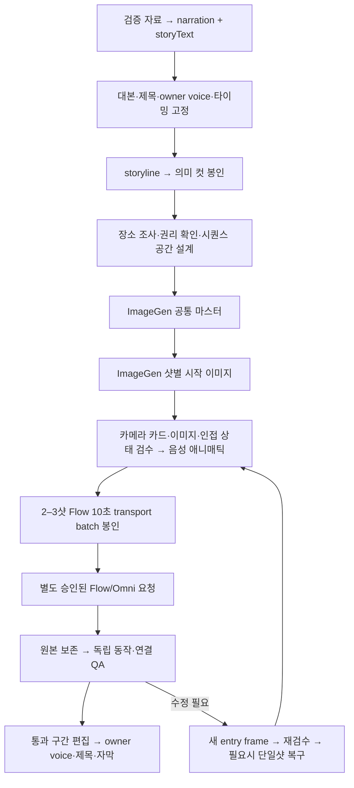

# ImageGen → Flow·Omni 영상 제작 운영 지침

2026-09-10 신규 제작 기본 경로: `newsroom-imagegen-flow-i2v-v3`. 상위 기준은 [canonical contract](newsroom-video-production.md)다. 기존 v2/Grok/hybrid/단일샷 artifact와 Flow 파일럿은 자동 이전하지 않는다.

목표는 **이미지 단계에서 외형·공간·카메라를 결정하고, 영상 단계에서는 샷마다 한 행동만 수행시키는 것**이다. fact spine과 동일 owner/profile/settings의 승인 역사 녹음 분포로 provisional timing을 만든 뒤 정상 계획에서는 9개 Flow 10초 batch(각 3 shot, 3/3/4초 source intent, 총 90초 picture source coverage)를 보낸다. 90초는 초기 재료 확보 목표이며 최종 런타임이나 narration 권위가 아니다. 확정 prompt bytes는 동결한다. 모든 provider 영상을 다운로드·보존·해시한 뒤 usable source window로 OpenCut picture rough를 먼저 만들고 semantic reconciliation과 사실 보존 final script conform 뒤 최종 owner narration을 잠근다. first-last-frame은 고위험 shot/recovery 보조 경로로 최소 4초 provider source를 요구한다. audio conform은 0.95–1.05 범위에서 최대 한 번이며 final factual AV QA 전에는 render하지 않는다.

## 1. 역할과 제작 순서

| 담당 | 결정하는 것 | 산출물 |
|---|---|---|
| Codex | 같은 검증 자료에서 한국어 narration과 영어 storyText, 사실·법률 검토, 시퀀스와 샷 설계 | 대본, 스토리, 샷 카드 |
| ImageGen | 인물·차량·소품·장소의 외형, 구도, 샷의 시작 순간 | 필요한 마스터, 샷별 단일 시작 이미지 |
| Flow/Omni | 순서대로 첨부한 entry frame과 샷 블록에서 피사체·카메라의 시간 변화 | 2–3샷 transport source |
| 독립 검수자 | 의미·한 행동·공간·외형·연속성의 실제 충족 여부 | 이미지/영상 검수 기록 |
| 로컬 편집 | 통과 구간 선택, 승인 음성·자막·제목 결합 | 검토본 및 별도 승인된 최종본 |



신규 Stage 03의 narration/storyText 동시 생성과 기존 critic은 유지한다. storyText는 사건 전개를 이해하는 산문이고 영상 모델에 다시 쓰라고 보내는 전체 대본이 아니다. 실제 owner voice가 잠긴 뒤 컷 ID·순서·근거·길이를 봉인한다. 이미지를 먼저 만들고 대본 길이를 억지로 맞추지 않는다.

## 2. 시퀀스부터 공간을 정한다

시퀀스는 같은 시간·장소에서 이어지는 사건 단계다. 각 시퀀스에 다음 기준을 하나만 둔다.

- 장소 범위: 확인된 도시/시기, 또는 사건과 무관한 일반적 지역 재현인지.
- 공간: 도로 폭, 차선 수, 보도·가드레일·건물 위치와 차량 진행축.
- 인물·물체: 역할, 복장, 차량 색·차체, 소품 크기, 차량 기준 좌석.
- 촬영: 카메라가 행동 축의 어느 쪽에 있는지, 피사체의 화면 진행 방향.
- 빛: 시간대, 날씨, 그림자 방향과 일관된 노출.

확인되지 않은 실제 현장 배치나 이동 궤적은 사건 사실로 만들지 않는다. 영상용 배치는 내부 설정으로 관리한다. 사실과 다른 궤적이 사건 의미를 바꾸는 경우 해당 행동 설계를 다시 검토한다.

인물은 기존의 현실적인 신체비율과 얼굴 없는 무광 마네킹 방향을 이어간다. 배경까지 매끈한 마네킹 재질로 바꾸지 않는다. 사람의 스타일과 장소의 재질을 프롬프트에서 분리한다.

## 3. 현실적인 배경을 만드는 방법

도시 이름에 `cinematic`, `futuristic` 같은 추상적 수식어만 더하지 않는다. 먼저 해당 지역의 보통 풍경을 조사하고 반복되는 관찰 가능한 특징을 기준표에 적는다. 한국 도심 예시는 실제 선택 장소에 맞는 아스팔트, 도색 차선, 보도 경계석, 낮거나 중간 높이의 콘크리트·벽돌 상가, 전봇대, 평범한 금속 가드레일, 자연광이다. 이 목록은 지역 근거를 대신하지 않는다.

**권리를 확인한 도시 사진 → ImageGen 배경 마스터 → 샷별 구도 합성**을 우선 사용한다. 직접 촬영하거나 사용 허락을 받은 사진, 항목별 권리문이 확인되는 공공·공개 사진을 조사한다. 검색 결과 썸네일이나 특정 플랫폼에 올라왔다는 사실만으로 업로드를 허용하지 않는다.

로드뷰는 공간을 이해하는 데 유용하다. 다만 열람 권한, 캡처·재사용 권한, 생성형 편집·provider 업로드 권한은 서로 다르다. 서비스별 이용 조건과 사진의 권리를 확인해야 한다. 권리가 불분명하면 사진을 다운로드하거나 ImageGen에 넣지 않고, 허용된 열람에서 파악한 비보호 사실을 기준표로 정리하거나 다른 허가된 사진을 찾는다. 사진을 이미 입력한 뒤 ‘텍스트 기준표만 사용’으로 기록해서는 안 된다.

특히 [Google Street View 지침](https://about.google/brand-resource-center/products-and-services/geo-guidelines/)은 화면 캡처·서비스 밖 다운로드, 이미지에서 데이터 작성·분석·추출, 이미지 병합을 제한한다. 따라서 Google 로드뷰를 자동 캡처해 ImageGen 배경으로 바꾸거나, 자동 분석·트레이싱으로 장소 기준표를 만드는 수집기는 두지 않는다. 텍스트 기준표는 이용 가능한 지역 설명·공개 사실·직접 관찰 등 독립 근거를 사용한다. 네이버·카카오의 허용 범위를 Google 규칙에서 추정하지 않는다.

장소 자료마다 origin URL, 촬영 장소·시기와 확인 수준, 저작자, 권리문·버전·확인일, 허용되는 상업 이용·변형·ImageGen 입력·결과의 Omni 입력 범위, 출처표시 의무를 기록한다. 사용 사진과 권리 증빙의 원본 hash를 보존한다. 생성 이미지로 바꿔도 원자료의 제한과 출처 의무가 자동 소멸하지 않는다.

한 시퀀스의 배경 마스터를 승인한 뒤 샷마다 재사용한다. 역방향·근접 구도가 필요하면 같은 마스터와 공간 기준에서 파생 구도를 만들고 건물·차선의 상대 위치를 확인한다. 새 도시를 매 샷 새로 생성하지 않는다. 교차로·차량 내부처럼 구조 오류가 잦은 공간은 대표 와이드와 필요한 반대 구도를 먼저 검토한다.

배경 생성 프롬프트 틀:

```text
Use case: stylized-concept
Asset type: reusable grounded location master for an illustrated news reenactment.
Input: [rights-cleared location image and its permitted role, or text-only location brief].
Place and era: [verified region/period; generic reconstruction when exact site is unknown].
Preserve these observed features: [road topology, building scale, materials, street furniture].
Camera and lighting: [physical camera position, natural light and weather].
Render ordinary real-world asphalt, concrete, brick, glass and fabric with restrained detail.
Keep the environment separate from the faceless matte mannequin character style.
Only include the objects required by the location plan. No invented futuristic architecture,
neon interfaces, holograms, floating structures, readable brands or decorative sci-fi elements.
This is an illustrative reconstruction, not photographic evidence of the incident.
```

## 4. 필요한 에셋만 만든다

반복 인물과 차량, 행동을 식별하는 소품, 반복 장소에만 마스터를 만든다. 컷마다 보이지 않는 인물까지 생성하거나 모든 배경 물건을 별도 PNG로 만들지 않는다. 한 에셋은 하나의 역할과 버전을 가지며 실제 사용한 생성 프롬프트·입력 이미지·결과 파일을 결합한다. 실패 이미지는 보존하고 active 선택에서 제외한다.

샷별 시작 이미지는 해당 마스터를 조합한 **단일 시점의 한 프레임**이다. 콘택트 시트, 스토리보드 격자, 여러 순간을 합친 콜라주는 검토 자료이고 첫 프레임 입력이 아니다. 행동이 끝나기 전의 상태여야 한다. 손·핸들·좌석이 중요한 샷은 그 관계가 읽히는 구도를 사용한다.

시작 이미지는 실제 decoded dimensions 기준 최소 변 480px 이상의 9:16 세로 구도여야 한다. 프롬프트에 9:16이라고 썼다는 사실만으로 통과시키지 않는다. 생성 결과의 비율이나 구도가 어긋나면 필요한 대상이 잘리지 않도록 ImageGen에서 새 버전으로 수정하고 다시 검토한다.

ImageGen에는 필요한 마스터와 허가된 합성 자료를 넣는다. Flow/Omni 기본 경로에는 각 샷의 완성된 entry frame만 authored order로 넣는다. 인물·차량·배경 마스터는 ImageGen provenance에 남기며 영상 모델이 다시 조립하게 만들지 않는다.

## 5. 샷 하나에는 관찰 가능한 행동 하나

각 카드는 `시작 상태 → 주체·동작·대상 → 관찰 가능한 결과 → 끝 상태`를 가진다. `actionCount=1`이라고 쓰는 것만으로 단일 행동을 입증하지 않는다. 카드 내용과 이미지·원본 영상의 검수가 필요하다.

| 복합 지시 | 분리할 행동 예시 |
|---|---|
| 차가 추월하고 끼어들어 급정지 | 추월 / 차선 이동 / 감속 정지 |
| 사람이 내려서 다가가 물건을 든다 | 하차 / 접근 / 들어 올리기 |
| 두 차선을 건너 앞차를 가로막는다 | 확인된 이동을 분해 가능한 컷으로 설계하고 경계 통과·최종 위치를 각각 검수 |

분리는 대본이나 봉인된 컷을 임의로 바꾸는 편집 편법이 아니다. 컷 변경이 필요하면 기존 컷의 근거·duration을 보존한 successor 계획을 다시 봉인한다. 모델이 실패한 사건 행동을 삭제하거나 다른 행동으로 바꿔 통과시키지 않는다.

각 샷은 `size`, `angle`, `position`, `composition`, `movement`, `axis`, `screenDirection`, `seat`, `focus`, `startState`, `endState`를 모두 가진 닫힌 camera card를 쓴다. `movement`는 `locked-off`를 포함해 한 종류만 허용하고, 좌석이 없는 샷은 `seat=not-applicable`을 쓴다. 같은 카드를 ImageGen entry frame, 사람 검수, 애니매틱과 Flow의 `[Shot n]` 블록에 그대로 결합한다. 자동차가 이동하는 동안 복잡한 카메라 회전을 함께 지시하지 않는다.

## 6. 샷 사이를 연결한다

연속 샷에서는 앞 샷의 exit state ID와 내용이 다음 entry state ID와 내용에 일치해야 한다. 차량·복장·소품·좌석·장소·빛·진행 방향도 유지한다. 화면 구도는 바뀔 수 있지만 세계의 상태가 순간이동해서는 안 된다.

시간·장소·주체 전환은 명시적인 전환 사유를 기록한다. 촬영축을 바꿔야 하면 관객이 방향을 다시 이해할 수 있는 와이드 또는 중립 구도를 설계하고 연결 검수를 한다. 상태의 동일성과 화면 좌우의 동일성을 혼동하지 않는다.

이전 영상의 끝 프레임을 다음 샷의 입력으로 계속 복제하는 방법은 기본값으로 쓰지 않는다. 외형·색·구조 오류가 누적될 수 있다. 필요할 때만 검수된 끝 상태를 참고하고 ImageGen이 승인 마스터에 맞춰 다음 시작 이미지를 만들게 한다. 변형된 provider 프레임을 새 canonical 인물/배경 마스터로 승격하지 않는다.

최종 타이밍에 맞춘 이미지 애니매틱을 owner narration과 함께 본다. 내용 중복·빠진 설명·시선 방향·동작 연결을 여기서 고친다. 끝 이미지가 도움이 되는 복잡한 경계는 별도 검토 이미지로 만들 수 있지만, 해당 provider surface가 끝 프레임 입력을 실제 지원한다는 증거 없이 필수 API 기능으로 가정하지 않는다.

## 7. Flow 10초 transport batch와 요청 검사

기본 모드는 `ordered-three-shot-flow10-transport`다. 샷마다 entry frame의 asset ID, contained relative file, bytes, SHA-256, role tag와 batch 내 order를 camera card와 manifest에 결합한다. 각 batch는 정확히 세 shot을 `[3.0, 3.0, 4.0]`초 source intent로 배분하고 10초를 요청한다. prompt는 정확한 10초 multishot 요청 문장, 정해진 mannequin·피부·복장 보존 문장, 빈 줄, ordered `[Shot n]` 블록 순서이며 공통 문장은 batch당 한 번만 쓴다. 각 블록은 `[참조 이미지: filename - Korean description]`으로 끝난다. role tag와 hash는 receipt 식별 정보이며 prompt 문법이나 native binding의 증거가 아니다. 정상 초기 계획은 9개 batch/27개 shot slot/90초다.

인계 deliverable은 역사본을 건드리지 않은 verified copy다. `README.md`, `SHA256SUMS.json`, plan count와 같은 `shot-images/`, combined txt/json/md와 `flow-ready-batches/B1.txt`…`Bn.txt`, `infinite-canvas/`, 종류별 base reference·generation record·manifest, `manifests-and-verification/`를 갖추고 모든 파일 hash를 검증한다. reference manifest는 선택된 자산과 미사용 자산 모두의 usage, provenance와 hash를 보존한다.

제출 전에 다음을 **실제 요청**과 대조한다.

- surface와 model 표기, 화면비, 요청 길이, 해상도.
- 업로드한 이미지의 exact media ID/hash와 packet의 file/tag/order.
- 실제 제출 프롬프트 UTF-8 bytes와 검토한 프롬프트 bytes.
- 실제 화면/receipt가 어떤 image binding을 제공했는지. 여러 이미지 첨부만으로 샷별 native first frame을 주장하지 않는다.

프롬프트는 장면을 새로 발명하는 장문의 설명보다 승인된 시작 상태, 한 행동, 결과, 진행 방향과 카메라를 중심으로 작성한다. 이미지에 이미 있는 인물의 외형을 다른 표현으로 반복해 충돌시키지 않는다. 실제 문구는 compiler가 한 번 만들고 inspector와 제출 단계가 같은 객체를 사용한다. local receipt 태그는 provider 공식 문법으로 취급하지 않는다.

10초와 `[3.0, 3.0, 4.0]`은 이 Flow batch의 source 요청 intent다. 실제 길이·해상도·FPS와 내부 샷 경계는 모든 provider 영상을 다운로드·보존한 뒤 측정한다. OpenCut은 usable window를 고르고 불필요한 프레임을 줄여 picture rough를 만든다. 최종 컷은 잠긴 owner narration과 봉인된 2–3초 duration을 따르고, 증거가 있는 필수/마지막 문장 경계만 1.5–3.5초다. 90초 source coverage, batch의 10초 또는 3/3/4 배분을 최종 narration/runtime으로 쓰지 않는다. first-last-frame은 고위험 shot/recovery에만 쓰고 provider source 최소 길이 4초를 요구한다.

각 batch는 같은 공간·시간·축에서 이어지는 정확히 3개 샷만 담고 전체 sealed order를 중복·누락 없이 덮는다. 하나의 entry frame이나 camera card가 바뀌면 batch prompt/hash, 해당 샷 검수와 현재 sequence 애니매틱을 다시 만든다. schema/compiler 통과는 provider 실행, native binding 또는 영상 의미의 통과가 아니다.

## 8. 원본 검수와 실패 복구

모든 provider source를 먼저 다운로드하고 원본 bytes를 보존·해시한 뒤 실제 duration/dimensions/FPS/audio를 측정한다. 생성기와 독립된 검수자가 선택 구간의 시작·중간·끝, 핵심 행동 시점과 전체 구간을 확인한다. 동작이 중간에 완성됐다 되돌아가는 경우를 세 장의 정지 프레임만으로 놓치지 않게 한다.

검수 기준은 의미 일치, 한 행동, 필요한 가시적 변화, 얼굴/추가 인물/문자 발생, 손·소품·차량·좌석·방향, 불필요한 내부 컷, 인접 샷 연결이다. `uncertain`과 `revise`는 통과가 아니다. 영상 원본 QA와 두 샷을 붙여 본 연결 QA를 각각 기록한다.

통과 후에만 authored duration과 ±0.05초 이내로 일치하는 연속 source 구간을 1배속으로 선택한다. source 오디오는 폐기하고 승인 owner narration을 사용한다. 1080×1920/24fps 최종 결과의 구체 레이아웃은 해당 승인 render profile을 따르며 기존 프로파일을 몰래 변경하지 않는다.

실패 시 원인을 `이미지/공간`, `실제 요청 불일치`, `동작 수행`, `샷 연결`로 나눈다. 오류 비용이 높은 샷을 batch 전에 분리하거나 multishot source QA가 실패한 샷만 `single-shot-i2v` 복구로 보낸다. 이때 실패한 entry frame을 그대로 재사용하지 않고 새 ImageGen 버전을 만들며 camera card, 샷·인접 상태와 현재 sequence 애니매틱을 다시 승인한다. 실제 surface receipt가 한 이미지의 native first-frame 입력을 확인한 뒤에만 그 binding을 기록한다. 이미 통과한 source는 보존하고 자동 provider 재시도는 하지 않는다.

제작 중 live builder를 수정하지 않는다. 도구 변경은 테스트를 마친 버전으로 고정하고, 새 제작 run에서 사용한다. 기존 UI 연결을 잃었을 때는 asset/media ID와 hash가 일치하는 receipt로 복구하고 근거 없이 PASS를 복원하지 않는다.

### 전체 제작 전 대표 샷 검증

새 모델·surface·compiler 버전을 쓸 때는 가장 어려운 대표 샷부터 검증한다. 차량 사건이라면 좌석 관계, 손과 소품, 이동 방향/차선 변화처럼 서로 다른 오류를 드러내는 샷을 고른다. 이는 최종 컷 수를 고정하는 규칙이 아니다.

각 샷은 camera card와 entry frame PASS, 현재 sequence 애니매틱 PASS, 실제 요청 일치, 원본 행동 PASS, 다음 샷과의 연결 PASS를 모두 충족해야 한다. 모델이 중요한 동작을 계속 실패하면 전체 영상을 먼저 생성하지 않는다. 입력 수·요청 길이·native multi-shot 기능이 바뀌면 이전 성공을 새 버전의 검증 증거로 재사용하지 않는다.

## 9. 구현과 권위 범위

`newsroom-flow-situation-board-v2` schema와 compiler는 camera card, exact entry-frame binding, 2–3샷 batch coverage와 prompt hash를 fail-closed한다. 성공한 검증은 이미지의 진실성이나 provider 실행, native first-frame binding, source semantic pass, 최종 영상 승인을 뜻하지 않는다. 외부 호출과 최종 제작 단계는 각각 실제 권위와 실행 증거가 필요하다.

기존 road-rage의 73.537792초 음성과 27컷은 paused preview다. [선택 manifest](../../06-production/opencut-automation/out/newsroom/flow-preview/road-rage-selected-7354-20260908/selection-manifest.json)의 위임 선택 제목을 이전 pending 제목으로 되돌리지 않으며, 그 제목 선택이 음성·storyline·cut-plan 승인을 대신하지도 않는다. 과거 preview/finish-preview와 거절 영상은 감사 이력으로 남긴다.

근거: [모델 문서·실제 제작 사례·배경 권리 조사](../sources/imagegen-omni-image-to-video-research-2026-09-10.md), [실패 진단](../../06-production/opencut-automation/out/newsroom/flow-preview/guide-first-two-20260908/DIAGNOSIS-20260908.md), [기존 Flow 운영 이력](flow-storyboard-director-production-guide.md).

## 10. 로컬 도구 사용

신규 Flow packet 진입점은 [compiler](../../06-production/opencut-automation/scripts/newsroom-flow-situation-board.mjs)와 [v2 schema](../../06-production/opencut-automation/production/newsroom/flow-situation-board.schema.json)다. 기존 [ImageGen/Omni CLI](../../06-production/opencut-automation/scripts/newsroom-imagegen-omni-i2v-cli.mjs)와 v1 schema는 이미지 provenance와 과거 단일샷 요청을 재검증하는 역사 도구이며 v2 Flow submission authority를 만들지 않는다.

작업 폴더 `06-production/opencut-automation`에서 실행한다.

```powershell
npm run test:newsroom-flow-situation-board
```

v2 packet은 코드에서 `compileFlowSituationBoard`에 exact reference 파일, camera card가 포함된 샷과 명시적 `transportBatches[{batchId,shotIds}]`를 전달해 만든다. 각 batch는 2–3개 shot ID를 authored order로 한 번씩 포함해야 한다. 현재 별도 provider CLI는 없으므로 이 packet을 live 실행 receipt로 승격하지 않는다.

아래 명령은 기존 v1 단일샷 artifact를 재검증할 때만 사용한다.

```powershell
node scripts/newsroom-imagegen-omni-i2v-cli.mjs help
node scripts/newsroom-imagegen-omni-i2v-cli.mjs init --output=i2v-draft-v1.json
```

`init`의 placeholder를 실제 현재 권위와 ImageGen 파일·생성 provenance·검수 기록으로 채운다. 존재하지 않는 승인 hash를 임의로 넣지 않는다. 새 프로젝트의 upstream 봉인은 [v9 성공 루트](../../06-production/opencut-automation/production/NEWSROOM_VIDEO_SUCCESS_ROUTE.md)의 `seal-entry`, `seal-visual`, `seal-references`를 사용한다.

```powershell
$i2vInputs = @(
  '--draft=i2v-draft-v1.json',
  '--visual=full-visual-storyline.json',
  '--references=imagegen-reference-catalog.json',
  '--storyline=storyline.json',
  '--cut-plan=semantic-cut-plan.json',
  '--entry-authority=entry-authority.json',
  '--legal-review=legal-review.json',
  '--title-approval=title-approval.json',
  '--owner-narration-approval=owner-narration-approval.json',
  '--supersession-reconciliation=supersession-reconciliation.json',
  '--asset-root=assets',
  '--evidence-root=evidence'
)
node scripts/newsroom-imagegen-omni-i2v-cli.mjs prepare-review @i2vInputs --output=i2v-review-bindings-v1.json
```

`prepare-review`는 현재 파일·권위에서 검수 대상 hash를 계산하고 pending 기록을 만든다. 이미지 검수와 owner-voice 애니매틱 검수를 실제로 수행하고 이 대상에 결합된 attestation을 기록한 뒤 다음을 실행한다. hash나 PASS를 사람이 추측해서 넣지 않는다.

```powershell
node scripts/newsroom-imagegen-omni-i2v-cli.mjs compile @i2vInputs --output=i2v-plan-v1.json
node scripts/newsroom-imagegen-omni-i2v-cli.mjs verify @i2vInputs --artifact=i2v-plan-v1.json
node scripts/newsroom-imagegen-omni-i2v-cli.mjs check-request @i2vInputs --artifact=i2v-plan-v1.json --capture=observed-request-receipt.json --receipt-root=receipts
```

위 파일명은 배치 예시다. 실제 승인 자료의 위치로 바꿔야 한다. 출력은 기존 파일을 덮어쓰지 않고 새 버전으로 기록한다. 검증 성공은 `planning-validated` 범위이며 실제 영상 생성 성공을 뜻하지 않는다.

실제 요청 검사는 `help`의 `check-request` 인자를 사용한다. 요청 기록은 UI inspector에서 관찰한 payload와 native media 매핑·물리 receipt를 보존해야 하며, 실행한 것으로 꾸민 로컬 예상값을 넣지 않는다. provider 실행 전에 확인하는 요청은 ‘관찰된 제출 전 요청’, 실행 후 기록은 ‘실제 제출 기록’으로 구분한다.

같은 진입점을 `npm run newsroom:imagegen-omni-i2v -- help`로 사용할 수 있다. 집중 검증은 `npm run test:newsroom-imagegen-omni-i2v`, 제작 인계 전 필수 회귀 검증은 `npm run test:editorial-cartoon-template`와 `npm run test:generic-pipeline`이다.
